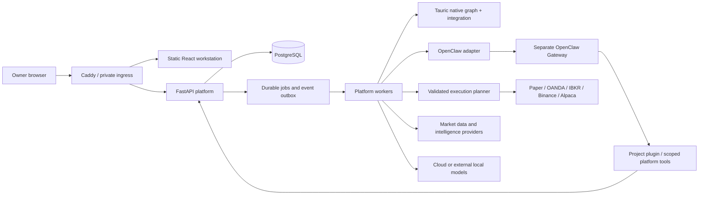

# Architecture review

Reviewed on 2 October 2026. This document records the original design review. Implementation progress is recorded in [requirements coverage](REQUIREMENTS.md) and [market and analysis verification](MARKET_ANALYSIS_VERIFICATION.md); the original gap table below is historical.

## Current state and agreed outcome

The Tauric directory was empty when inspected. There is no frontend, backend, database, Docker configuration, integration, strategy engine, journal or test suite to preserve. Its parent directory is a Git checkout containing other projects. Future work must remain inside Tauric and must not stage or alter sibling projects.

The owner selected the full platform, autonomous trading, OANDA/IBKR/Binance/Alpaca, Binance spot and futures, cloud and local model support, one owner account, and a separate OpenClaw service. M+ is the initial test host. Local models will run on another machine or service rather than consume the VPS's application memory.

The supplied brief defines product intent. Its technology suggestions and examples are candidates, not requirements to install every named package. A small implementation milestone must not be presented as the completed full release.

## What the upstream systems actually provide

### Tauric TradingAgents

Inspected upstream revision `8b22d43d01d9ddda5d686d093d5385884622f3de`, whose release documentation identifies v0.5.2. Development version 0.2.0 now installs this exact revision in a separate worker. Offline cloud/local graph compilation passes. Development 0.6.0 completed a real daily BTC run with all nine original report fields; see [connected AI verification](CONNECTED_AI_VERIFICATION.md). Required additional instrument/time contexts remain pending.

The selected analysts feed the native research debate, research manager, trader, risk debate and portfolio manager. Preserve that graph. It exposes per-run configuration, callbacks, streaming and checkpoint support. Its programmatic analysis accepts a date and returns state plus a rating; it does not return a broker order. [Graph implementation](https://github.com/TauricResearch/TradingAgents/blob/8b22d43d01d9ddda5d686d093d5385884622f3de/tradingagents/graph/trading_graph.py), [graph setup](https://github.com/TauricResearch/TradingAgents/blob/8b22d43d01d9ddda5d686d093d5385884622f3de/tradingagents/graph/setup.py).

The trader schema permits missing entry and stop prices. Native structured decisions are rendered to text, so the adapter must capture validated outputs where available and preserve original reports. A rating alone cannot authorize execution. [Agent schemas](https://github.com/TauricResearch/TradingAgents/blob/8b22d43d01d9ddda5d686d093d5385884622f3de/tradingagents/agents/schemas.py), [trader implementation](https://github.com/TauricResearch/TradingAgents/blob/8b22d43d01d9ddda5d686d093d5385884622f3de/tradingagents/agents/trader/trader.py).

The inspected data router has vendor mappings, rather than a verified public extension API for arbitrary execution feeds. Stock/crypto paths and date cutoffs do not establish intraday FX or futures correctness. Keep required extensions in a narrow, versioned Tauric integration package with compatibility tests; preserve the native debates. [Data router](https://github.com/TauricResearch/TradingAgents/blob/8b22d43d01d9ddda5d686d093d5385884622f3de/tradingagents/dataflows/router.py).

### OpenClaw

The latest upstream release returned by GitHub during this review was `v2026.9.7`. Pin and test a release before packaging it; do not deploy a moving `latest` tag. [Release](https://github.com/openclaw/openclaw/releases/tag/v2026.9.7).

Use its supported Gateway APIs and a project-owned plugin exposing narrow platform tools. Agent invocation can use the documented HTTP interface; tools, skills and scheduling should use native extension surfaces. Keep runtime tokens private to the backend. These interfaces carry operator authority and must remain on private ingress. [HTTP API](https://docs.openclaw.ai/gateway/openai-http-api), [tools](https://docs.openclaw.ai/tools), [automation](https://docs.openclaw.ai/automation).

Skills describe workflows; executable tools call authenticated platform APIs. Prompts alone cannot enforce execution permissions or record immutability. OpenClaw receives neither broker secrets nor unrestricted write access to the trading database.

## UI review

The reference is a strong visual direction: dark navy, cyan panel labels, compact tables, gold identity and visible account context. Keep its workstation character, numeric alignment and persistent navigation.

The account cards and allocation forms consume much of the screen while the chart, journal and assistant compete in small panels. Put account allocation in Accounts/Settings and retain a compact account selector and exposure strip in the trading workspace. The screenshot's chart has too little space for its toolbar and annotations.

Place the chart and scanner in the main workspace, Tauric analysis and OpenClaw governance in separate tabs in the right dock, and positions/orders/journal in the bottom dock. Use one detail drawer for resources and a full resource page when needed. The assistant should be expandable rather than permanently occupying another small panel.

Replace generic LIVE labels with explicit execution mode, connection state and data timestamp. Do not imply a demo account, websocket connection or successful analysis means live execution is enabled. Display scores only when supplied by a documented model or configured scanner, with their meaning visible.

Use React/TypeScript with Vite for a browser application; a separate server-rendering runtime is unnecessary for this private workstation. Use FlexLayout for docking, splitters, tabs and persisted layout models. Use Lightweight Charts with custom overlay modules and the required attribution. These choices fit workstation interaction and reduce server processes. [FlexLayout](https://github.com/caplin/FlexLayout), [Lightweight Charts](https://github.com/tradingview/lightweight-charts).

Design tokens: background `#06101C`, panel `#0B1A2A`, borders `#223D54`, cyan `#24C8F4`, gold `#F4B84A`, text `#DDE8F3`; profit/loss also use labels and signs. Use Barlow Condensed for restrained panel headings, IBM Plex Sans for controls, and IBM Plex Mono for prices and tables, self-hosted with license notices. Support comfortable, compact and terminal density. On narrow screens use a single active panel with tabs; do not squeeze the whole terminal into miniature cards.

The distinctive UI element is a trade lineage rail connecting evidence, Tauric, governance, calculation, order, fill and outcome. It doubles as navigation and makes the product's auditability visible.

## Gap analysis

All platform functionality is absent locally. Complexity is relative engineering effort, not an estimate of delivery dates.

| Requirement | Current state | Gap | Recommendation | Priority | Complexity |
|---|---|---|---|---|---|
| Installable application | Empty directory | Entire application and packaging | Modular backend, static frontend, Compose | P0 | High |
| Configuration and audit | None | Historical resolution and ownership | Versioned settings and immutable snapshots | P0 | Medium |
| Native Tauric integration | Upstream inspected only | Adapter, persistence, market extensions | Preserve graph; isolate extensions | P0 | High |
| OpenClaw governance | Upstream inspected only | Supported plugin and validated records | Private Gateway and narrow platform tools | P0 | High |
| Account/strategy attribution | None | Fill ownership and capital accounting | Separate broker net from virtual ledgers | P0 | High |
| Execution correctness | None | Sizing, idempotency, reconciliation | Shared planner and paper/live adapters | P0 | High |
| Intraday and futures | Not validated upstream | Context, timing and product semantics | Explicit coverage and integration tests | P0 | High |
| Four live brokers | None | Credentials, APIs, product capabilities | Dedicated adapters and verified capability matrix | P0 | High |
| Workstation and charts | Reference image only | Real data, layouts and drill-down | Docked workspace and modular overlays | P1 | High |
| Scanning and intelligence | None | Ingestion, provenance and scheduling | Configured sources, entities and universes | P1 | High |
| Research and chart explanations | None | Point-in-time replay and artifacts | Shared evidence access and isolated research | P1 | High |
| Journal, analytics, notifications | None | Outcome projections and delivery | Build from persisted lineage/events | P1 | Medium |
| Server readiness | M+ named; host not inspected | Measured capacity and deployment proof | Preflight, soak test, recovery exercise | P0 | Medium |

## Architecture decisions

### Runtime and ownership

Use a Python/FastAPI modular monolith with workers, PostgreSQL, and a static React frontend behind Caddy. Keep database, runtime and broker endpoints off public ports. Add an independently pinned OpenClaw service. Tauric runs inside a dedicated worker process using the integration package; it does not need a separate public API. IBKR connectivity has its own private TWS/IB Gateway dependency. [IBKR connectivity](https://www.interactivebrokers.com/docs/tws-api/doc/introduction).

PostgreSQL owns accounts, configuration, decisions, execution, attribution, audit records and job state. Use indexed time-series tables initially; add TimescaleDB only when ingestion/query measurements justify it. A PostgreSQL job queue with leased work and an outbox avoids another always-on service on M+. Queue delivery may repeat, so handlers and side effects must be idempotent. Git owns application, strategy and OpenClaw extension source. Export historical datasets to versioned Parquet artifacts. Defer Honcho and a separate wiki service until there is a concrete need.

### Configuration and records

Define settings with type, validation, supported scopes, sensitivity and restart behavior. Resolve preferences in the explicit order global → user → account → portfolio → style → strategy → strategy version → instrument, using only scopes applicable to that key. Build context from the deployment's recorded references, not caller-supplied arbitrary IDs. For hard risk limits, evaluate all applicable limits instead of allowing a more specific preference to relax an account cap.

Each change records actor, timestamp, reason, previous/new values and revision. Restore creates a new revision. Execution and analysis capture an immutable effective snapshot; future changes cannot alter prior decisions. Keep secrets in mounted private secret files or encrypted storage, with redacted references in snapshots and logs.

Store evidence, Tauric decisions, governance, execution plans, order events and fills as separate records linked by IDs. Enforce immutability of finalized decisions and audit events in the database and service permissions. OpenClaw may create a new reassessment; it cannot update the original decision. Mutable current-state projections are rebuildable from the event history. Preserve reports and concise rationale without exposing private model reasoning traces.

### Trading and accounts

Separate strategy identity, immutable version and deployment. A deployment selects portfolio, capital pot, account, mode, routing and execution policy. Generic portfolios and nested capital pots are data entities, not market-name branches. Research, shadow, paper, limited live and live are seeded mode definitions with explicit capabilities.

Use Decimal for authoritative quantities, amounts, fees and conversion. Broker adapters expose instrument specification, account state, quotes, order submission/cancellation, execution reports and reconciliation. API financial values use decimal strings. Reject unsupported capabilities explicitly; do not silently translate an unsupported order into another order type.

Maintain virtual strategy positions separately from broker positions, with attribution attached to every fill. Opposing virtual exposures may offset inside a netting account without claiming nonexistent broker fills: record explicit internal allocations and associate real broker fills with the net external order. Track allocated fees, realized/unrealized results and account reconciliation separately. Strategy exits change that strategy's allocation and only the required broker net delta. Unattributed external trades create discrepancies rather than invented ownership.

Autonomous means no routine per-order approval after the owner enables a deployment and configures its policy. Fresh installs start with live execution disabled and no active trading deployments. Require valid inputs, account capabilities, data health, configured policies and completed reconciliation before execution. A governance permit cannot override deterministic validation. Keep an immediately accessible halt control; existing protective orders are managed according to an explicit shutdown policy.

Persist an order intent and stable broker correlation ID before network submission. If submission times out, enter an unknown state and query/reconcile before retrying; database idempotency alone cannot prevent a duplicate at a remote broker. Serialize planning for shared account/instrument exposure and reserve pending risk atomically. Handle partial fills, cancel/fill races, reconnects, restarts and manual broker activity.

### Data, intelligence and research

Use normalized instrument IDs with provider/broker mappings, tick/quantity increments, contract multipliers, quote/settlement currencies, sessions and product capabilities. Keep spot and derivative contracts distinct. Record event time, received time and available time plus source/dataset version. Distinguish exchange volume, broker tick volume and unavailable volume.

A central as-of data interface serves historical charts, research and analysis. Historical ingestion cannot be declared contemporaneously available merely because its published timestamp is old; historical availability requires provenance or a qualified dataset. Enforce exact timestamp cutoffs, including within a day, at all evidence access points. Upstream date-based filters alone are insufficient for this requirement.

Scanners use configured universes, cadence, features, ranking and shortlist limits. Indicators/structure overlays have versioned deterministic algorithms; a drawing is not evidence that a setup is valid. Instant chart inspection uses data without an AI call. Explain runs on demand; deep investigation is a queued workflow. Show point-in-time and retrospective modes explicitly.

Normalize news, economic events, company announcements, research, social posts and rumours into a provenance-bearing intelligence model. People, companies, relationships and themes are editable entities. Keep rumours and their resolution history distinct from confirmed facts. Provider connectors need real access and coverage verification; a generic connector interface does not complete a promised feed.

Store research hypotheses, code/data versions, parameters, cost assumptions and artifacts. Start with one deterministic replay/backtest runner using the shared paper execution semantics. Optional LEAN/vectorbt/Qlib/RD-Agent/FinRL integrations are not requirements to install all engines. Research cannot publish or deploy a strategy by bypassing versioning and configuration services.

### Interfaces and upgrade boundaries

Use Pydantic/OpenAPI as the API contract source, generate TypeScript clients, and namespace public endpoints under `/api/v1`. Resource references contain a type and ID; drawers and full pages share the same resolver. Use WebSockets for authenticated quote, job and resource updates with sequence/cursor support and reconnect resynchronization.

OpenClaw tools initially cover requesting analysis, reading lineage/portfolio context, submitting governance and proposing configuration diffs. Execution remains a platform service. Version the plugin and adapter together, keep source in this project, and run compatibility tests against both the pinned and proposed upgrade versions. Update Tauric or OpenClaw independently after their respective suites pass. Database migrations are explicit; application rollback must respect migration compatibility.

## What to simplify and what to postpone

The brief is strongest on lineage, user-owned configuration, native Tauric reasoning and broker/virtual position separation. Those foundations should be implemented early because they are expensive to retrofit.

Avoid dozens of services, universal registries without users, duplicating OpenClaw's scheduler, a second risk debate, and installing every research or memory tool. Use registries only where multiple implementations already matter: brokers, data/model providers, sizing, overlays and panel factories. OpenClaw owns orchestration and channels; the platform owns financial state and authority.

The first useful milestone is an authenticated workstation with persistent settings, configuration history and saved layouts. It is deliberately intermediate. Full release completion still includes real Tauric/OpenClaw workflows, paper execution, attribution, intelligence, scanners, research, analytics, notifications and all selected live brokers.

Defer additional broker implementations beyond the selected four, external users/multi-tenant hosting, same-VPS model inference, extra research engines, distributed execution, a generic plugin marketplace and TimescaleDB/Redis until justified. These are not silently removed from an agreed essential workflow; they are optional extensions or deployment choices.

The largest risks are unverified market semantics, broker-specific fill behavior, historical leakage, ambiguous AI outputs, uncertain remote order submissions, data entitlement gaps and memory pressure on M+. Address them with vertical integration tests and measured deployment evidence, not additional abstraction.

## Development 0.3.0 paper boundary

The paper implementation keeps original native artifacts immutable and introduces separate owner proposals, governance decisions, deterministic plans and attributed fills. Account policies are explicit immutable versions, not source-code risk preferences. Account locks and request/consumption uniqueness prevent competing plans or retries from spending a balance twice. Virtual positions and realized cash/P&L are reconstructed from opening and closing fills, with independent strategy attribution even on the same symbol.

The independent OpenClaw 2026.9.7 image loads project tools from a distinct package boundary. In development 0.4.0, cloud/local agents retrieve bound immutable job context through the private API and return strictly validated paper governance. Saved Settings are refreshed privately; credential/configuration changes invalidate pending results. The separate review worker holds the queue lease and writes the final decision after checking context, policy and ledger. It has no broker order path. The Gateway has no database connection, report-writing, shell or order tool. Cron, memory, model heartbeats and automatic model fallback remain disabled. Service readiness is separate from real model/provider verification. See [governance verification](GOVERNANCE_VERIFICATION.md).

Development 0.5.0 adds account-scoped fixed-USDT portfolios and nested pots as append-only allocation versions. Children reserve budgets; direct parent trades use unallocated capacity. Each new entry consumes capital, risk and position limits along its entire ancestry. Account locks serialize allocation edits and paper fills. Proposals pin the allocation digest; governance captures allocation state; plans/fills retain exact scope/version lineage. Edits advance account revision and block stale review/plan use. Fresh held-instrument marks are rechecked immediately before fill. Legacy history is preserved without inventing user allocations. See [capital verification](CAPITAL_VERIFICATION.md).

Development 0.6.0 separates strategy identity, immutable parameter versions and immutable paper deployments. Each registered deployment pins its version and explicit account/allocation; a new version never mutates existing routes or positions. Append-only pause/resume controls block new proposals, queued permission use and stale plans, while explicit attributed closes remain allowed. Account locks serialize controls and fills; control changes advance account revision and require fresh proposals even after resume. Fill lineage carries the pinned version. These parameters configure paper limits, not executable signal rules or changes to the native graph. See [strategy verification](STRATEGY_VERIFICATION.md).

Development 0.7.0 adds a deterministic manual crypto scanner as another consumer of the existing market snapshots and native queue. Immutable profile/candidate/run/match/event/admission records preserve exact evidence and strategy references; current eligibility is derived without rewriting history. PostgreSQL serializes admission and reserves daily per-strategy-version job counts. Context-keyed research reuse and worker-side eligibility checks bound repeated/stale model work. Native graph inputs/analysts are unchanged; candidate features are linked evidence, not injected native observations or order authority. Real OpenClaw bound-context rejection and downstream planning denial are verified separately. See [scanner verification](SCANNER_VERIFICATION.md) and [real governance verification](REAL_GOVERNANCE_VERIFICATION.md).

Development 0.8.0 adds a separate durable web-chat queue and owner-only Telegram/Discord native channel configuration. Project OpenClaw package 0.5.0 still wraps unchanged upstream 2026.9.7. A dedicated chat agent/workspace has only the read-only status/original-report tool; governors retain only their bound review tool. Browser chat uses the authenticated Tauric API and server-owned Gateway credentials. Bot configuration versions are encrypted, allow only positive numeric owner IDs and disable groups/remote commands. Web and per-channel histories are isolated. See [chat architecture, setup and verification](OPENCLAW_CHAT.md).

Development 0.9.0 adds two narrow chat research tools. The request factory binds the trusted SDK owner/channel/session/call ID and checks its invocation guard before the private POST. The backend rechecks the active web lease or configured native owner DM, serializes immutable admissions and shares daily allowances/reuse across channels. The original native queue/graph/artifacts remain authoritative; completed reports and trading records are not rewritten. Web turn projections link actual native job status and original report IDs. Configuration revisions are captured and checked before execution. See [chat verification](OPENCLAW_CHAT.md).

Research and analytics add append-only owner-bound dataset/run records, closed-bar retrospective SMA replay and read-only projections from verified paper fills. Research execution is bounded to 5,000 candles and synchronous, has no model/deployment/order authority, and retains algorithm source artifacts and checksums. Snapshot receipts remain retrospective rather than certifying historical availability. Account projections take the existing fill lock and reconcile realized outcomes to ledger totals. See [research and analytics](RESEARCH_ANALYTICS.md).
