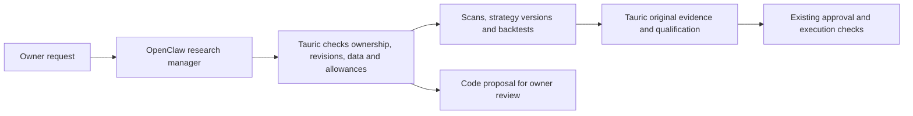

# OpenClaw project manager and simpler workflows

Updated 7 October 2026. This upgrade implements research management and reviewable code proposals. It does not implement reinforcement learning or automatic code deployment.

## Everyday workflow

Use **Scanners → My scans** to choose markets, setup families and automation. Timing, ranking and research limits are under Advanced settings. New scans start disabled, with automatic scanning/research off and zero research allowance. Defaults for timeframe and filters are visible when expanded. Saving keeps existing unedited filter settings and creates a new immutable version.

Use **Scanners → Opportunities** to review current setups. The default view shows ready and watched setups. Search by symbol or scan name, filter the market, or switch to all recent results to find dismissed and expired setups. Watch, dismiss, open the chart, read original evidence, or request Tauric daily research. A setup score describes screening rules; it is not a measured probability of profit.

Use **Strategies → Strategy library** to save an idea, rules and version settings. Breakout details are expandable. **Paper routes** shows the existing account/market routes and pause/resume controls. Creating a version leaves all deployed versions unchanged. Trading account and allocation setup remains in Settings, with a shortcut to the strategy library.

Use **OpenClaw → Project controls & action history** to review saved actions, hypotheses and upgrade drafts. The shortcut buttons prepare an unsent message. Scanner and strategy pages also offer Ask OpenClaw; these open a general conversation so global management cannot escape a portfolio's scope. Page destinations survive reload and support browser back/forward.

## Authority

OpenClaw can read project state, selected source code, documentation and immutable research, plus closed paper trade performance. Performance is explicitly labeled closed_paper_trades; it excludes full marked equity and consolidated broker demo outcomes. Its management tool supports exactly ten operations:

The optional [Knowledge library and local Honcho/Obsidian memory](KNOWLEDGE_AND_MEMORY.md) adds research-note and preference retrieval for a permitted local chat route. The current remote chat route is blocked from saved memory under the owner's local-only choice. Memory cannot change trading authority or project/privacy permissions.

| Operation | Result |
| --- | --- |
| save_scanner | New scanner version using the existing registry and configuration checks |
| run_scanner | Manual deterministic screening run |
| candidate_action | Watch or dismiss a saved candidate |
| research_candidate | Existing native admission checks, freshness, eligibility and research allowances |
| create_strategy / revise_strategy | Immutable strategy version; no deployment change |
| capture_dataset | Immutable closed-candle dataset from a saved market snapshot |
| run_backtest | Existing typed retrospective replay with explicit costs |
| save_research_note | Hypothesis, evidence, counter-evidence, test plan and decision |
| prepare_upgrade | Source references/checksums, changes, planned tests and optional patch for review |

The backend has no manager operation to place an order, deploy a strategy, change account or portfolio risk limits, edit native reports, write source, change permissions, or bypass approval. Governed entry agents retain their original read-only tool lists. General project tools reject portfolio conversations; scoped portfolio tools and their saved permissions continue to apply there. Configured owner Telegram/Discord direct messages may use the general manager tools, through the existing identity checks. This does not certify channel delivery or authorize proactive messages.

Both new tools bind identity from the trusted Gateway invocation. The private backend verifies the service token, owner, channel, account and active web-chat lease. Browser sessions cannot call these private endpoints. Input schemas come from the same validated services used by the UI. A request is recorded before the service effect; a completed receipt is recorded afterward. Stable request identities and immutable input binding recover an interrupted response without changing the original operation or repeating a saved effect. Receipts reject database updates/deletes, and completion must match its original request.

Source access is limited to a code/documentation allowlist, bounded excerpts and hashes. Runtime credentials, sibling projects and paths escaping the source root are unavailable. API images include a build-time source copy for review. There is no shell or source-write tool. An upgrade receipt always says review required, code unapplied, and validation not run. Its planned tests must be executed separately before approving a software change. Source checksums catch a stale proposal; a saved patch is still an unvalidated draft.

## Quant research workflow

OpenClaw is instructed to follow this process and preserve the evidence in research notes:

1. State a falsifiable hypothesis and why the effect might exist.
2. Inspect data quality, source code and original evidence.
3. Compare against a simple deterministic baseline.
4. Check execution costs, regime dependence, time leakage, small samples and counter-evidence.
5. Save the experiment and a decision: test, reject, or needs data.
6. Prepare a concrete upgrade proposal when implementation is necessary.

This is a research workflow, not proof of quantitative skill or profitable trading. The tools and prompt have been tested with offline fixtures; live model reasoning quality needs evaluation against recorded tasks and deterministic baselines. Native daily research still does not certify an intraday strategy.

## Is it time for reinforcement learning?

**Start the research foundations now; defer a production trading policy.** This is a project-specific engineering judgment based on the [project audit](PROJECT_AUDIT_2026-10-06.md) and the current [trading readiness work](LIVE_AUTOTRADING.md). Since the audit, executable-side FX stop checks, marked portfolio observations, replacement protection and prospective promotion gates have been implemented. These improvements do not provide a trained policy or evidence of a trading edge. The saved breakout baseline remains unqualified, and observed forward outcomes, frozen comparisons and an execution-aware learning dataset still need to be established. Breakout replay exits and broker-held protection can follow different paths; their agreement must be measured before a learner can be trusted to optimize that environment.

FinRL's research architecture explicitly includes market friction, liquidity and risk constraints. That supports building an execution-aware evaluation environment before interpreting a learned policy's results. [FinRL paper](https://arxiv.org/abs/2111.09395)

The next work should be:

1. **Execution parity:** verify executable-side stop, gap, spread, slippage, latency, protection and financing assumptions against broker demo facts. Keep differences between replay assumptions and observed execution explicit.
2. **Outcome data:** record point-in-time scanner features, chosen/rejected candidates, executable costs, marked equity and delayed outcomes. Keep observed facts distinct from retrospective estimates. Define how non-selected candidates receive a comparable research-only outcome.
3. **Frozen evaluation:** version the dataset, features, simulator, policy and reward. Use chronological training/validation/test periods, time separation where labels overlap, walk-forward checks, multiple seeds and a final untouched period. Existing qualification helps for supported breakout research; a generic replay does not create these splits automatically.
4. **Baselines and selection bias:** compare no-trade, current deterministic rules, a simple statistical ranker and OpenClaw recommendations on the same observations. Count all attempted experiments. Trying many alternatives can inflate apparent performance; a single held-out success is insufficient. [Backtest overfitting research](https://www.davidhbailey.com/dhbpapers/backtest-prob.pdf)
5. **First learning experiment:** prefer a narrow offline candidate-ranking or research-priority problem. It should output a recommendation only. Consider supervised calibration or a bandit baseline before a full sequential RL policy. This is a proposal, not an implemented capability.
6. **Independent forward evaluation:** run the frozen candidate model in shadow mode alongside existing rules. Evaluate costs, turnover, drawdown, stability and failure behavior. Set a sample requirement based on signal frequency and uncertainty; no fixed number of calendar days proves an edge.

An RL recommendation must pass the same Tauric evidence, qualification and approval path as any other proposal. It cannot rewrite original reports, increase risk limits or authorize an order by itself. No new training loop, model reward, autonomous source editing or learned execution policy is enabled by this upgrade.

## Verification and rollout

The backend/API, pinned OpenClaw plugin/configuration, frontend build and browser flows are verified separately. Browser fixtures use synthetic candles and a synthetic upgrade draft, with no model or broker order calls. Evidence is recorded in `artifacts/assistant-upgrade-verification.json` and the accompanying test logs/screenshots.

Migration `0030_assistant_management` adds the append-only request/receipt table. Apply it before running the updated API/chat worker. Build the API, native worker, web and OpenClaw images together so source, tool schema and Gateway allowlists agree. Keep the existing native runtime pin. Local preview verification does not certify a production server rollout or model quality; use the established backup and release procedures for a server.
