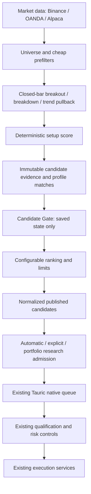

# Candidate discovery pipeline

The scanner finds and scores setups. Candidate Gate filters saved state. Ranking prioritizes surviving candidates. Tauric handles intelligence; the existing risk and execution services retain trade authority.



Research results do not execute a trade automatically. The last two arrows represent existing downstream responsibilities, not new execution authority granted by a scanner. Scheduled discovery publishes a shortlist. A separate coordinator consumes those receipts when the profile enables automatic research.

## 1. Previous architecture and reused components

`scanner.py` previously combined manual screening, profile/history handling, immutable candidate persistence, watch/ignore actions, daily research admission, queue reuse/budget checks and native-worker admission validation. Discovery already made zero model calls, but had no score, downstream position/order gate, ranking limits or scanner schedule. Portfolio opportunity shortlists ranked raw volume ratios separately.

Retained components:

- `market.refresh`: registered Binance spot, OANDA Forex and Alpaca stock/ETF adapters, cached snapshots and source semantics.
- `closed_bar_breakout_v1`: existing long breakout detector, prior-high and relative activity conditions. Forex calendar/price-side checks and stock regular-session verification are preserved.
- Scanner profiles and append-only revisions, shared candidate evidence, exact strategy/profile matches, fixed expiry, watch/ignore and ownership/checksum checks.
- Existing PostgreSQL `AnalysisJob` queue and single native worker. There is no separate event bus; append-only scanner events are the publication receipts.
- Independent strategy-monitor schedules and broker lifecycle workers. They remain responsible for managing positions, reconciliation and execution.

## 2. Simplification and boundaries

`scanner_discovery.py` contains the data prefilters, detector and score. `scanner.discover` reads the configured universe, persists evidence/profile matches and emits normalized `potential_candidates` before the gate. It never reads orders, positions, portfolio exposure, macro/news, model connections or strategy promotion state.

`candidate_pipeline.py` owns Candidate Gate, normalized publication and ranking. `candidate_research.py` owns AI-route selection, allowances, compatible daily-job reuse, native enqueueing and admission validation. The API and native worker call this downstream research service. Small forwarding functions in `scanner.py` preserve existing Python callers.

The stock detector still reuses `stock_execution.detect`; its function only screens completed market data. Other functions in that existing module remain unchanged.

## 3. Implemented scanner flow

1. Read enabled instruments from a saved profile; skip individually disabled instruments before requesting market data.
2. Reject stale/missing data, gaps, insufficient closed bars and configured session/price/volume/volatility/spread failures.
3. Evaluate each selected setup family against the same fetched candles. Ignore forming candles. No setup means no candidate.
4. Compute a score in `[0, 1]` and apply the profile/strategy discovery threshold.
5. Persist shared evidence and the exact profile match, preserving existing deduplication and expiry semantics.
6. Gate and rank downstream, then record the normalized shortlist in `ScannerRun.published_candidates` and append publication receipts.

Scores use `0.5 + 0.25 × breakout_quality + 0.25 × activity_quality`, rounded to six decimal places. Breakout quality clamps breakout percent to `[0, 1]`; activity quality clamps the volume ratio divided by twice its configured minimum to `[0, 1]`. These are simple evidence scores, not predicted returns or calibrated probabilities. Forex activity means provider ticks, stock activity means selected-feed shares, crypto activity means exchange-base volume.

## 4. Candidate contract

All supported assets use `PotentialCandidate` in `scanner_contracts.py`:

```json
{
  "candidate_id": "<existing evidence UUID>",
  "created_at": "<timezone-aware timestamp>",
  "symbol": "GBP/USD",
  "instrument_id": "oanda:fx:GBP_USD",
  "asset_class": "fx",
  "strategy_id": "<stable strategy UUID, or detector ID for unlinked discovery>",
  "strategy_version": "<pinned strategy revision, or detector revision>",
  "direction": "long",
  "timeframe": "5m",
  "setup_score": 0.82,
  "features": {"close": "1.32", "volume_ratio": "3.1", "breakout_percent": "0.23"},
  "market_data_timestamp": "<detected closed candle timestamp>",
  "scanner_id": "<stable scanner profile UUID>",
  "scanner_version": "2",
  "profile_version_id": "<exact saved profile UUID>",
  "dedupe_key": "<setup identity hash>",
  "trace_id": "<scan request UUID>",
  "strategy_priority": 0
}
```

The existing asset names (`crypto_spot`, `fx`, `equity`, `etf`) and intervals (`1m`, `5m`, `15m`, `1h`, `4h`, `1d`) are retained. Features remain exact decimal strings. Candidate views expose `setup_score` and `potential_candidates` for their profile matches; normalized run publications carry the originating scan trace. Several strategies can share one evidence UUID while retaining separate normalized strategy contexts.

Evidence deduplication remains the existing exact evidence checksum. Downstream setup deduplication uses stable strategy identity, instrument, detector, direction, timeframe and closed candle. Different filter settings on the same strategy/candle cannot cause repeat publication. The same strategy remains active across strategy revisions.

## 5. Candidate Gate behavior

The gate reads persisted facts once per cycle and uses deterministic reason codes:

- `DUPLICATE`: this setup was already published, or duplicate input reached ranking.
- `PROCESSING`: this strategy/instrument has a queued/running scanner or portfolio candidate research job.
- `PENDING_ORDER`: a matching unresolved broker entry intent, or an unconsumed, unexpired paper entry plan exists.
- `OPEN_POSITION`: an attributed paper entry has no matching exit, or the existing broker cursor/receipts indicate an active or uncertain holding. Partial fills on cancelled entry orders remain active until saved lifecycle evidence confirms closure.
- `COOLDOWN`: another setup for this strategy/instrument was published within the configured interval.
- `EXPIRED` / `IGNORED`: reused evidence is no longer eligible for publication.

Unattributed legacy orders/positions conservatively suppress the instrument. An unlinked scanner also suppresses the instrument when an active position/order cannot be associated with its detector. Opposing directions do not bypass the active strategy/instrument check.

The gate never calls a broker, reconciles holdings, computes portfolio risk or manages exits. It consumes state produced by existing services. Final risk/execution services remain necessary because state can change after admission.

The explicit candidate-research endpoint rechecks the gate and ranking, so it cannot bypass selection by passing an arbitrary candidate UUID. Worker admission rechecks open/pending state before native launch. Existing compatible daily jobs, including failed jobs, can be reused without starting another model process or charging another allowance. Reusing a job does not publish another candidate or authorize a new trade.

Portfolio shortlists use the same gate/ranking, and native admission retains the source candidate/profile for revalidation. Older saved shortlists without that profile field resolve their existing eligible match.

## 6. Ranking behavior

Sort by descending setup score, descending strategy priority, newest closed candle, then stable instrument/strategy/setup/profile/candidate identities. Equal inputs have deterministic ordering. Duplicate setup inputs are collapsed.

After gating, each profile enforces its configured minimum score, cycle count, asset-class count and strategy count. Defaults shortlist at most two candidates. Portfolio research also keeps its existing portfolio shortlist limit when combining scanner profiles. Lower-ranked evidence stays inspectable; it grants no research admission while outside the current selection.

## 7. Configuration and cadence

Existing settings and saved profiles remain valid. New defaults:

| Setting | Default | Behavior |
| --- | --- | --- |
| `minimum_setup_score` | `0.50` | Discovery threshold |
| `strategy_scores` | `{}` | Minimum score/priority overrides keyed by linked exact strategy-version ID or unlinked detector ID |
| `ranking.minimum_score` | `0.65` | Research shortlist threshold |
| `ranking.max_candidates_per_cycle` | `2` | Total per profile cycle |
| `ranking.max_candidates_per_asset_class` | `2` | Per asset family |
| `ranking.max_candidates_per_strategy` | `2` | Per stable strategy |
| `cooldown_seconds` | `0` | Optional cross-profile setup cooldown |
| `automatic_enabled` | `false` | Explicit opt-in scanner scheduling |
| `automatic_research_enabled` | `false` | Separate downstream automatic research admission |
| `detector_ids` | `[]` | Selected setup families; empty preserves the legacy single `detector_id` |
| `scan_seconds` | `30` | Normal cadence |
| `watch_scan_seconds` | `10` | Live candidate/watch cadence |
| `evaluate_on_candle_close` | `true` | Scheduled detector evaluation skips unchanged closed candles |
| `max_data_age_seconds` | `960` | Maximum receipt/provider age; existing adapters can impose stricter freshness |
| `disabled_instruments` | `[]` | Skip before provider access |
| `require_active_session` | `false` | Optional open-session filter |
| `minimum_price`, `maximum_price`, `minimum_volume` | unset | Optional observable prefilters |
| `minimum_volatility_percent` | `0` | Minimum completed-bar range as a percent of close |
| `maximum_spread_bps` | unset | Requires observed bid/ask data when configured |

The universe limit increases from 10 to 1,000 registered instruments. Missing configured spread evidence fails closed; no synthetic spread is invented. Calendar/session semantics remain provider-specific.

The UI exposes score thresholds, cycle limit, cooldown, cadence and opt-in scheduling. Additional per-strategy/asset limits and prefilters are available through the existing profile API; UI edits preserve those settings.

`scanner_worker.py` is an independently restartable deterministic worker, added to development Compose and available locally through `python scripts/local.py scanner`. It uses saved run timestamps, current profile revisions and the existing advisory lock; the oldest due profile runs first. Live unignored candidate/watch matches use the shorter cadence. Restart does not discard cadence state. Existing provider refresh caches still apply. No profile is automatically enabled, and scheduled runs never enqueue intelligence.

## 8. Tests and observability

`test_candidate_pipeline.py` adds scoring bounds, schema/trace checks, no-model discovery, no setup, stale data, disabled instruments, price/volume/session/spread prefilters, strategy-specific thresholds, duplicate/cross-profile suppression, processing/open/pending/cooldown checks, deterministic ranking and all count limits, direct-request bypass prevention, persisted paper/broker state, queued admission revalidation, restart cadence and a 100-instrument fixture cycle.

Existing scanner, independent-profile, migration, stock, portfolio and other backend regression tests remain in use. The existing built-browser workflow checks the new controls along with independent profiles, evidence, research reuse, history and desktop/mobile layout.

Every run records universe size, prefilter passes, detections, discovered candidates, gate rejections, ranking rejections, published count, scan duration and pipeline duration. Rejection codes appear on run results and in the scanner panel. Audits contain compact cycle metrics; failed instruments do not store verbose model payloads.

The fixture performance artifact is `artifacts/scanner-pipeline-performance.json`. It measures a full discovery/gate/ranking cycle using synthetic offline HTTP and disposable PostgreSQL, not live-provider throughput. Final verification: 835 checks passed in the full backend regression run; 17 optional browser cases were excluded there. The final affected scanner/stock/portfolio/upgrade run, including the built scanner browser workflow, passed 73 checks. Frontend production build, backend lint/format checks and development Compose configuration validation passed. The final 100-instrument fixture recorded 0.530 seconds for discovery and 0.619 seconds for the pipeline, with two publications, 98 ranking rejections and zero model calls. Machine-readable evidence: `artifacts/scanner-pipeline-verification.json`.

## 9. Migrations and rollout

No scanner database migration is required. New parameters and run/candidate fields use existing immutable JSON payloads. Older profiles receive defaults when read; older candidate scores are deterministically derived from their existing features. Original requests, checksums, evidence, matching history and fixed expiry are not rewritten. The original scanner rollout used `0028_broker_routes`; the separate market-intelligence increment subsequently advanced the shared preview to `0029_market_intelligence`.

API definitions and frontend types are regenerated. Rebuild matching API/native-worker/frontend services and start the scanner worker to use opt-in scheduling. Existing profiles remain manual until explicitly changed.

The owner subsequently authorized a controlled preview rollout on 5 October 2026 (London time). Matching API, native worker, frontend and background-service images are deployed, including the new scanner worker. A private database backup was made before deployment. All 106 backend module checksums match across nine backend services, the served frontend assets match the production build, and preview readiness is healthy. Existing model connections, market connections, strategies, broker routes, trading policies and budget settings retain their original checksums.

One independent `BTC / ETH rollout` profile is enabled against real Binance public data: one-minute closed candles, 20-bar lookback, activity ratio at least 2, research score at least 0.65, one ranked candidate per cycle, five-minute cooldown, 30-second normal cadence and 10-second candidate cadence. New explicit research admissions are capped at one per UTC day through the existing configured external local AI route. Scheduled discovery never enqueues research. The worker resumed from durable profile/run state after a restart. The post-rollout scanner/research suite passed 61 checks, including persisted position/order suppression and queued admission revalidation in the disposable test database.

Live BTC/ETH feeds were fresh and gap-free with 299 closed candles each. Observed real cycles took about three seconds and skipped unchanged candles. A genuine BTC breakout then scored 0.691153 against the 0.65 admission threshold: its closed price exceeded the prior 20-bar high, with an activity ratio of 2.91056785. It passed gate/ranking and one fresh native research job was admitted through the external local AI route. The saved scanner context matched the actual candidate; while research was running, the read-only repeat gate returned `PROCESSING`. Repeating the admission request preserved one job and one charged admission.

The native job succeeded in 241 seconds on pinned Tauric runtime 0.5.2. Its stored checksum, original request, upstream revision and required public reports were verified. Execution authority is false and no governance/trade authority is attached. After completion, the real candidate's repeat gate returned `DUPLICATE`. This completes the live discovery-to-research acceptance checkpoint. Persisted position/order suppression and queued revalidation are additionally verified in the disposable test database. Evidence and repeatable inspection: `artifacts/scanner-preview-verification.json`, `scripts/scanner_preview_check.py`, and `scripts/scanner_rollout_acceptance.py`. The latter's `admit` action uses one fixed request identifier to prevent repeated research admissions for this rollout. Discovery continues on the saved schedule; further research still requires existing explicit or separately enabled portfolio admission.

The owner then authorized multiple setup families and automatic research. Profile revision 2 enables long breakout, short breakdown and trend pullback plus the separate research coordinator, retaining the one-new-job daily allowance and prior thresholds. The updated preview passes source and service checks across ten backend services. Six live cycles at the initial checkpoint produced no qualifying publication; no new automatic native job was admitted. The full backend suite passed 872 checks, and 122 affected checks included the built scanner interface. Current behavior and the separate automatic-rollout evidence are documented in [automatic scanners](AUTOMATIC_SCANNERS.md).

## 10. Remaining work

- Long breakout, short breakdown and long/short trend pullback are implemented. Further setup families can extend the data-only detector boundary and emit the same contract.
- Small-cap and event/macro scanners remain unavailable because the repository lacks their required universe/evidence adapters. No market-cap, catalyst, news or macro assumptions were fabricated.
- Scoring is a bounded heuristic; calibrating weights separately for asset/strategy families needs evidence outside this architecture task.
- Universe reads use existing bounded provider adapters sequentially. The fixture benchmark makes cycle duration visible; live-provider rate limits and latency may require a later bulk-data adapter.
- Automatic candidate-to-research admission now complements explicit/portfolio admission. Candidate-to-trade dispatch remains a separate reviewed trading responsibility.
